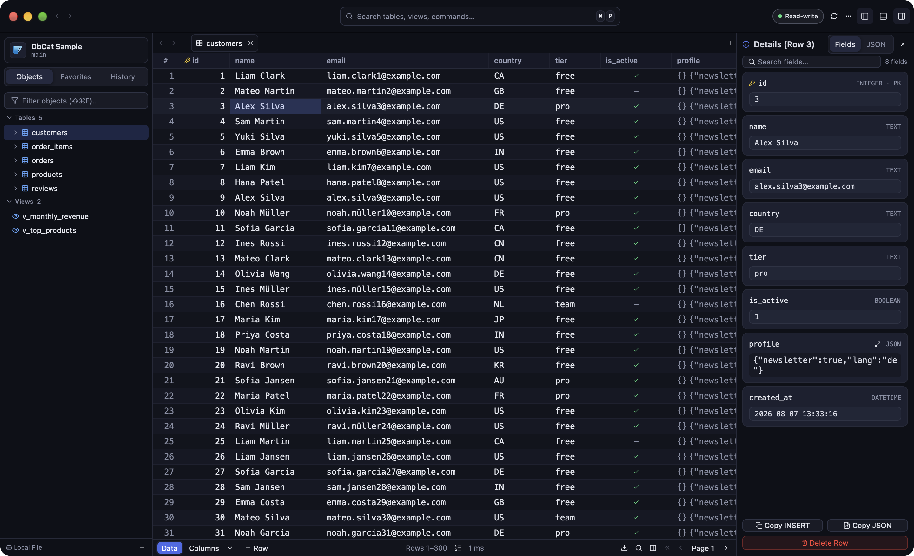
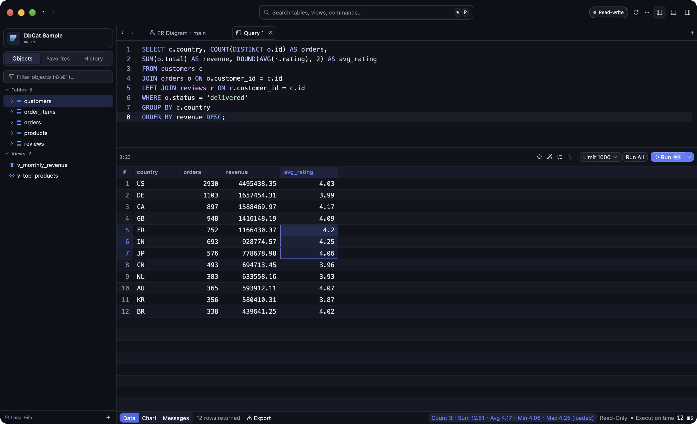
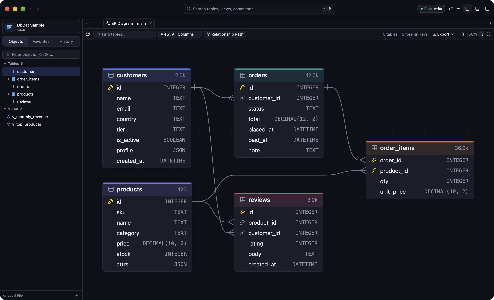
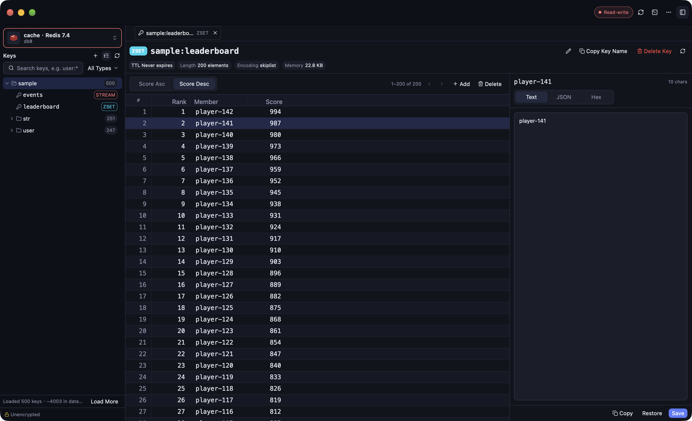
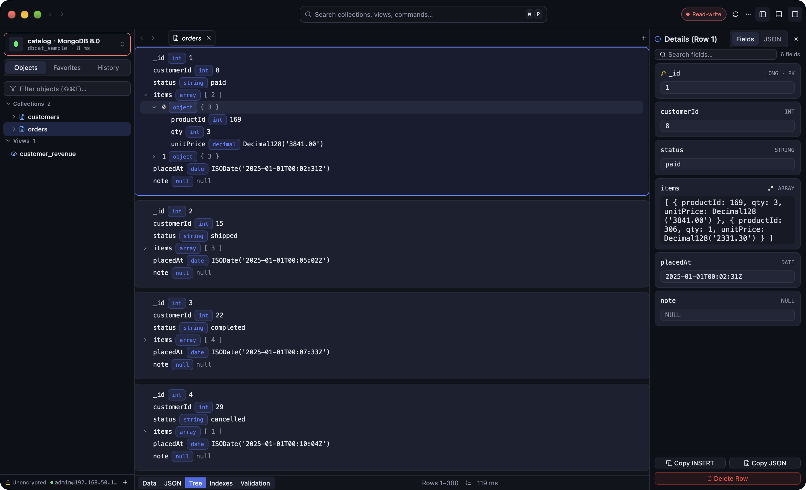

# DbCat

**A fast, native database client for macOS and Windows, built with Rust.**

[Website](https://dbcat.forzens.com) · [Download](#-download) · [Issues](https://github.com/dbcat-app/dbcat/issues) · [Releases](https://github.com/dbcat-app/dbcat/releases)

**English** | [简体中文](README.zh-CN.md)

---

## ⚡ Why DbCat

Many database tools run on Electron, a WebView or the Java runtime, which makes them slow to start and heavy on memory. DbCat is written in native Rust and draws its UI directly on the GPU:

- 🦀 **Native, no browser inside**: no Electron, no WebView. It opens instantly.
- 🚀 **Smooth on large tables**: rows load page by page (300 per page), so the first page of a million-row MySQL table opens in about 1.3 ms. Every database call runs on a background thread, and the UI stays responsive during slow queries.
- 🛡️ **Passwords stay in the system keychain**: database and SSH passwords and key passphrases are stored only in the macOS Keychain or Windows Credential Manager. They are never written to config files or logs, and DbCat has no telemetry or tracking.
- 🚦 **Guardrails for production**: read-only connections and confirm-before-write. Edits are staged first, and you review the SQL before committing them in one go.

---

## 🗄️ Supported Databases

| Type | Database | Highlights |
| :--- | :--- | :--- |
| Relational | **MySQL** | 5.7 / 8.x; foreign keys, triggers, stored procedures; full and multi-schema backup & restore |
| Relational | **MariaDB** | 10.x / 11.x; sequences, CHECK constraints, account locking and roles |
| Relational | **TiDB** | MySQL-compatible distributed database · query plans, backup & restore |
| Relational | **PostgreSQL** | Multiple schemas, materialized views, extensions; full and multi-schema backup & restore |
| Relational | **CockroachDB** | PostgreSQL-compatible distributed database · query plans, backup & restore |
| Relational | **SQL Server** | T-SQL, schemas, Windows / Kerberos / Entra ID authentication |
| Embedded | **SQLite** | Local files, zero configuration |
| Embedded | **DuckDB** | Local .duckdb files · in-place editing |
| Analytical | **ClickHouse** | MergeTree table options, partition and sorting keys |
| Key-value | **Redis** | Key browser, six data types, console, Pub/Sub, ACL; standalone / Sentinel / Cluster |
| Key-value | **Valkey** | Same capabilities as Redis: key browser, console, Pub/Sub, ACL, Sentinel and Cluster |
| Document | **MongoDB** | Edit in place in Table / JSON / Tree views, mongosh-syntax queries, indexes and validation rules |

> More databases are on the way.

---

## ✨ Key Features

- **📊 Browse and edit tables in place**: paged loading opens million-row tables instantly; 13 filter operators and server-side sorting. Changes are staged, and you review the SQL before committing them in one go.
- **📝 Query editor**: context-aware completion for tables and columns, query parameters, multiple result sets, split view and query plans, with timeouts and row limits to keep you safe.
- **📐 Visual structure editor**: edit columns, indexes, foreign keys and triggers. DbCat generates the DDL for you to confirm before applying it.
- **🕸️ ER diagrams**: automatic layout of every table and foreign key in a database. Search to jump to a table, focus on related tables, and double-click to open one.
- **📦 Import, export and backup**: export to CSV / JSON / SQL and import from CSV. Full and multi-schema backup & restore for MySQL, MariaDB, TiDB, PostgreSQL, CockroachDB, SQL Server, SQLite and ClickHouse, plus backup & restore for MongoDB, Redis and Valkey.
- **🤖 AI integration (MCP)**: a built-in MCP server you can add to Claude Code, Codex, Cursor, Claude Desktop and other AI tools with one click in Settings. AI tools launch DbCat in the background when they need it. It is off by default, and each connection is authorized separately (off / read-only / changes need approval / changes without approval). Changes proposed by AI show up in DbCat with the statement, the estimated number of affected rows and the reason, and run only after you approve them. Passwords never pass through the AI tool.
- **🔒 Secure connections**: SSH tunnels (password / private key / ssh-agent), SSL/TLS certificate verification, and color tags for production environments.
- **⌨️ Keyboard first**: `⌘P` (`Ctrl+P` on Windows) to open a table, `⌘K` (`Ctrl+K`) to switch databases, multiple tabs and split panes, and shortcuts for common actions.
- **🌐 English and Chinese UI**: follows your system language by default; switch it any time in Preferences.

---

## 🖼️ Screenshots

<table>
  <tr>
    <td width="50%"> <b>Query editor</b> with results and selection statistics</td>
    <td width="50%"> <b>ER diagram</b> with automatic layout</td>
  </tr>
  <tr>
    <td width="50%"> <b>Redis</b> key browser and value editor</td>
    <td width="50%"> <b>MongoDB</b> documents in tree view</td>
  </tr>
</table>

---

## 📥 Download

Supports macOS 12+ and Windows 10/11 (x64). macOS builds are notarized by Apple, and both platforms update themselves automatically.

- 🍏 **[macOS · Apple Silicon](https://dbcat.forzens.com/download?arch=arm64&lang=en)**
- 💻 **[macOS · Intel](https://dbcat.forzens.com/download?arch=x86_64&lang=en)**
- 🪟 **[Windows (x64)](https://dbcat.forzens.com/download?os=windows&lang=en)**
- Previous versions and release notes: [Releases](https://github.com/dbcat-app/dbcat/releases)

> **Platform notes**
> - **macOS**: built-in auto-update notifies you of new versions, upgrades in one click and picks the right build for your Mac's chip.
> - **Windows**: the installer is an unsigned beta. If SmartScreen appears, click "More info" → "Run anyway". It also updates itself (users on 0.7.0 or 0.7.1 need to install a newer version from the website once).

---

## 💬 Feedback

- [GitHub Issues](https://github.com/dbcat-app/dbcat/issues)
- In the app: `Help → Report Issue…` in the menu bar, which pre-fills your app and OS versions.

This repository hosts releases and the issue tracker only; it does not contain source code.
